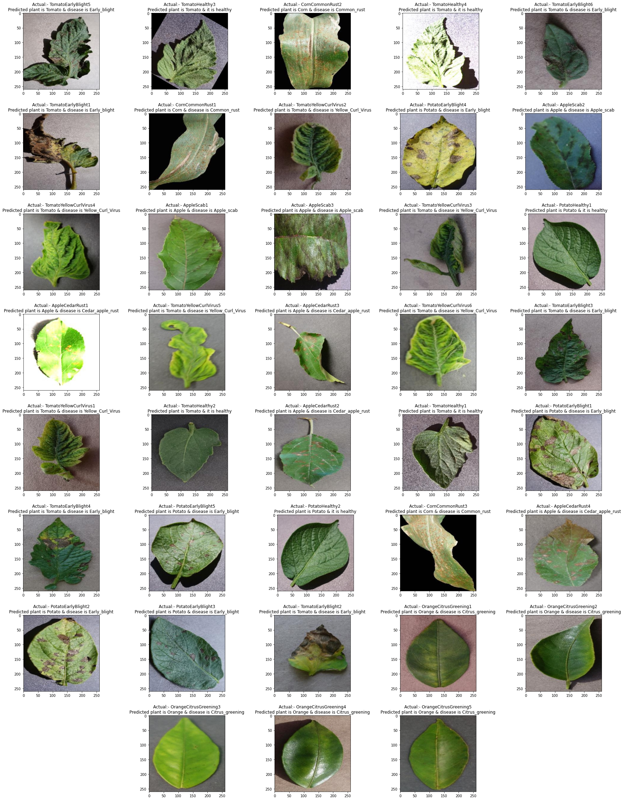

# PlantDis: Plant Disease Detection from Leaf and Drone Images

PlantDis is a Flutter application for analysing plant leaf images with local deep-learning models. It can classify a plant species, predict a disease class, segment a leaf from its background, and process every leaf in a drone image as one batch.

The repository also contains the training notebooks and earlier PlantDis clients that preceded the current Flutter application. PlantDis was first developed for the ANU course COMP4560 under the supervision of Prof. [Graham Williams](https://cecs.anu.edu.au/people/graham-williams).

- User manual: [PlantDis Application User Manual](https://github.com/spsaswat/plantdis/wiki/PlantDis-Application-User-Manual)
- 2026 pitch video (2–3 min demo of the desktop drone workflow): <https://youtu.be/DSwiBgOhnF4>

> [!IMPORTANT]
> PlantDis is a research and teaching project. Its predictions are not a substitute for diagnosis by a plant pathologist or agronomist. Do not use the output alone to make treatment, chemical application, quarantine, or biosecurity decisions.

## Keywords

Plant disease detection, image classification, computer vision, deep learning, transfer learning, nested transfer learning, TensorFlow Lite, ONNX Runtime, Mask R-CNN, Flutter, plant phenotyping, drone imagery, Segment Anything Model (SAM), agricultural AI.

## Current capabilities

The current application lives in [`ui_dev/flutter_test_application_1`](ui_dev/flutter_test_application_1).

- Analyse a single leaf image selected from the gallery.
- Capture an image on platforms with camera support.
- Detect the plant species before running a species-specific disease model.
- Segment leaves with ONNX or TensorFlow Lite models. ONNX is the default.
- Run without an account in local guest mode on desktop platforms.
- Use Firebase authentication and cloud storage on configured platforms.
- Request disease-care suggestions through Gemini or OpenRouter when API keys are supplied.
- Select a drone image on desktop and process each leaf as part of one batch.
- Find the leaves in a drone image in three ways: draw them by hand, detect them automatically with a local Mask R-CNN leaf model, or import masks generated by SAM from a NumPy `.npy` file.
- Review and correct every mask in one mask editor before processing: draw round an area to add it or erase it, add or delete masks, pan, zoom, and undo.
- Open contextual, illustrated help for drawing masks by hand or reviewing detected and imported masks.
- Track completed, failed, cancelled, and partially completed drone batches.
- View per-leaf results and a batch summary with species counts, disease counts, healthy/diseased totals, dominant disease, and average confidence.

## Demos

| Demo | Link |
| --- | --- |
| Desktop drone workflow (2026) | [Pitch video on YouTube](https://youtu.be/DSwiBgOhnF4) |
| Flutter mobile app (2025) | [`op_m_readme/PlantDis_demo.gif`](op_m_readme/PlantDis_demo.gif) |
| Legacy Linux desktop client with the MLHub backend (2022) | [`op_m_readme/desk_demo.gif`](op_m_readme/desk_demo.gif) |

<p align="center">
  
</p>

## Supported plant classes

The species classifier recognises 14 labels:

`apple`, `blueberry`, `cherry`, `corn`, `grape`, `orange`, `peach`, `pepper`, `potato`, `raspberry`, `soybean`, `squash`, `strawberry`, and `tomato`.

Dedicated disease classifiers are bundled for:

- Apple
- Corn
- Grape
- Pepper
- Potato
- Tomato

Other recognised species fall back to the generic inference path. A recognised species does not guarantee that PlantDis has a dedicated disease model for it.

## Repository components

| Path | Purpose | Status |
| --- | --- | --- |
| [`ui_dev/flutter_test_application_1`](ui_dev/flutter_test_application_1) | Current Flutter application, local/cloud storage, leaf analysis, AI suggestions, and drone batch processing | Active development |
| [`ipynb`](ipynb) | Model training and experimental notebooks | Research material |
| [`SAM-Model-Server-end`](SAM-Model-Server-end) | Python/Flask resources for SAM-related experimentation | Experimental |
| [`mlhub`](mlhub) | Original MLHub command-line package | Legacy |
| [`plantdis_flutter`](plantdis_flutter) | Original Linux Flutter desktop client | Legacy |
| [`plantdis_mob`](plantdis_mob) | Original Flutter mobile client | Legacy |

The setup instructions below apply to the current application. Legacy components keep their own README files.

## Requirements

- Flutter SDK 3.41.7 (the version used by CI)
- Dart SDK compatible with `^3.7.0`
- A platform toolchain for the target device, such as Android Studio, Xcode, Visual Studio with desktop development tools, or Linux desktop build dependencies
- Git
- The large model files listed below

Optional cloud storage, sign-in, and AI suggestions require separate service configuration.

### Model files not stored in Git

The species and disease classifiers are committed under [`assets/models`](ui_dev/flutter_test_application_1/assets/models). The segmentation and background models are larger and are excluded by `.gitignore`; some exceed GitHub's 100 MB file limit. Obtain them from the project team and place them at these paths inside `ui_dev/flutter_test_application_1`:

| File | Used for | Size |
| --- | --- | --- |
| `assets/models/leaf_mask_rcnn_v2.onnx` | ONNX leaf segmentation in single-leaf analysis (default) | ~176 MB |
| `assets/models/best_float32.tflite` | TensorFlow Lite leaf segmentation in single-leaf analysis | ~90 MB |
| `assets/models/background_detector_quant.tflite` | Leaf/background check before segmentation | ~44 MB |
| `assets/models/desktop/leaf_mask_rcnn_v3.onnx` | Automatic leaf segmentation of drone images | ~184 MB |

Files under `assets/models/desktop/` are bundled into Windows, macOS, and Linux builds only, so mobile builds do not carry the drone model. The app builds without these files, but the features that use a missing file cannot run.

## Quick start: local guest mode

Local guest mode stores images and analysis records on the device and does not require a PlantDis account.

```bash
git clone https://github.com/spsaswat/plantdis.git
cd plantdis/ui_dev/flutter_test_application_1
# copy the model files listed above into assets/models/
flutter pub get
flutter run
```

Select **Continue as Guest** on the welcome screen. On macOS and Windows, turn off **Save data on cloud** to force local storage. Linux uses local guest mode without showing the cloud toggle.

To choose a target explicitly:

```bash
flutter devices
flutter run -d <device-id>
```

The repository contains projects for Android, iOS, macOS, Windows, Linux, and Web. On every push and pull request to `main` that changes the app, CI runs the Flutter tests and static analysis, builds an Android debug APK, and builds debug versions for iOS, Windows, macOS, and Linux. CI does not build Web or release versions, and it builds without the model files above; verify release builds before distributing them.

## Optional cloud mode

Cloud mode uses Firebase Authentication, Cloud Firestore, and Firebase Storage. The repository contains platform configuration used by the project, but a maintainer must provision the Firebase project, authorised applications, security rules, indexes, and credentials for a deployable environment.

The welcome screen offers cloud sign-in on Android, iOS, macOS, and Windows when Firebase is configured. Linux uses local guest mode.

Do not commit private keys, service-account files, or production credentials.

## Optional AI suggestions

PlantDis can request follow-up suggestions from Gemini or OpenRouter. Disease classification does not depend on these API keys; the keys only enable AI-generated guidance and chat features. The chat page offers Gemini Flash and Gemini Flash Lite (Gemini key), and Llama 4 Scout and Qwen3 30B (OpenRouter key).

Copy the example file and add one or both keys:

```bash
cd ui_dev/flutter_test_application_1
cp api_config.json.example api_config.json
```

```json
{
  "geminiApiKey": "YOUR_GEMINI_API_KEY",
  "openrouterApiKey": "YOUR_OPENROUTER_API_KEY"
}
```

You can also point the app to another file:

```bash
export PLANTDIS_API_CONFIG=/absolute/path/to/api_config.json
flutter run
```

Or pass keys at build/run time:

```bash
flutter run \
  --dart-define=GEMINI_API_KEY=YOUR_GEMINI_API_KEY \
  --dart-define=OPENROUTER_API_KEY=YOUR_OPENROUTER_API_KEY
```

Never place real API keys in tracked files. AI-generated suggestions may be incomplete or incorrect; verify them with a qualified source.

## Inputs

### Single-leaf analysis

PlantDis accepts images selected through the platform image picker. Cloud uploads accept:

- JPEG (`.jpg`, `.jpeg`)
- PNG (`.png`)

The gallery flow requests a maximum width and height of 1024 pixels and an image quality of 85 from the picker. Classifiers resize their input to RGB `224 × 224` pixels.

For useful results:

- Use one visible leaf as the main subject.
- Keep the leaf in focus and avoid severe motion blur.
- Use even lighting where possible.
- Avoid covering symptoms with hands, labels, or other objects.
- Do not assume that confidence measures real-world diagnostic certainty.

No minimum capture resolution or maximum source-file size has been formally validated or enforced across every platform.

### Drone batch analysis

The drone flow is available on Windows, macOS, and Linux. It first checks the image filename and EXIF metadata for common consumer-drone identifiers. Examples include DJI, Mavic, Phantom, Inspire, Matrice, Autel, Parrot, and Skydio. A missing or unrecognised identifier can cause the app to reject an otherwise valid aerial image.

After selecting an image, choose one segmentation mode:

1. **Manual segmentation** — draw one mask per leaf in the mask editor.
2. **Automatic segmentation** — detect the leaves with the bundled Mask R-CNN model (`maskrcnn_resnet50_fpn_v2`, one `leaf` class), then review or edit each mask.
3. **Import SAM masks (.npy)** — load a SAM mask array generated outside the app, then review or edit each mask.

Automatic segmentation runs on the device, in the background, before the image is uploaded or stored. It splits the image into `1024 × 1024` tiles with 35% overlap, as the model was trained, keeps detections with a score of at least `0.5`, and merges the tiles into one mask per leaf. Progress is shown as a percentage and the run can be cancelled. A large image can take several minutes.

The `.npy` file for SAM import must:

- use NumPy format version 1, 2, or 3;
- use C ordering, not Fortran ordering;
- contain `bool` or `uint8` values;
- have shape `(N, 1, H, W)`, `(N, H, W)`, or `(H, W)`;
- match the selected image's oriented width and height.

Generate masks from the exact image selected in PlantDis. Resizing, cropping, or rotating one file without applying the same operation to the other will cause a dimension mismatch. Empty masks are ignored.

Each leaf region must be at least `16 × 16` pixels in the selected source image. PlantDis records smaller regions as failed instead of enlarging them for classification.

SAM does not run inside the Flutter application.

## Outputs

### Single-leaf result

The application can display and store:

- detected plant species;
- species-classification confidence;
- predicted disease class;
- disease-classification confidence;
- a segmented image URI or cloud URL when segmentation succeeds;
- an optional care recommendation or AI-generated suggestion;
- analysis status and error information.

### Drone batch result

Each drawn, detected, or imported mask becomes one leaf record. The batch output includes:

- total and analysed leaf counts;
- healthy and diseased counts;
- disease counts and species counts;
- dominant non-healthy disease;
- average confidence across completed leaves;
- per-leaf species, disease, confidence, crop, segmentation output, status, and error message;
- batch state: `processing`, `completed`, `partial`, `cancelled`, or `error`.

In local guest mode, the app stores records and processed images under the operating system's application-support area. In cloud mode, it uses Firestore and Firebase Storage.

PlantDis currently presents results in the application UI. The repository does not define a stable public REST API or CSV export schema.

## Sample data and verification

The [`test`](test) directory contains leaf images for manual trials, including examples for apple, corn, orange, potato, and tomato. Before redistributing or publishing a derived test bundle, confirm the licence and provenance of every image.

Additional project test data is available in the [PlantDis Microsoft Teams channel](https://teams.microsoft.com/l/channel/19%3AqBKIRpxhBLNRl44WRLeEgxsiE1ynNRPMwRuB0dceZMQ1%40thread.tacv2/General?groupId=69f873d0-972a-44a4-8ed2-9e81d08c0240&tenantId=e37d725c-ab5c-4624-9ae5-f0533e486437). Access requires permission to the corresponding ANU Microsoft Teams workspace.

Some filenames in `test/` describe an expected disease, such as `AppleCedarRust1.JPG`, `CornCommonRust1.JPG`, `PotatoEarlyBlight1.JPG`, and `TomatoYellowCurlVirus1.JPG`. The current Flutter test suite does not run these files through the bundled models and assert those classes. The repository therefore does not yet provide a deterministic end-to-end model benchmark with fixed inputs, expected classes, model checksums, and confidence tolerances.

Run static analysis and the automated Flutter tests from the current app directory:

```bash
cd ui_dev/flutter_test_application_1
flutter pub get
flutter analyze --no-fatal-infos
flutter test
```

Run the integration tests on a configured device:

```bash
flutter test integration_test/app_test.dart -d <device-id>
flutter test integration_test/performance_test.dart -d <device-id>
```

The test suite covers models, storage helpers, services, widgets, UI flows, SAM mask parsing, Mask R-CNN post-processing, mask editing, and drone batch behaviour. Automated software tests verify code behaviour; they do not establish biological or diagnostic accuracy.

## Validation status and limitations

Historical training notebooks contain evaluation results, including accuracy, precision, recall, and confusion matrices. Saved notebook outputs include:

- `99.24%` test accuracy, micro-precision, and micro-recall for a 22-class EfficientNetB2 experiment in [`ED_22_3E_ft_Or_EfficientNetB2.ipynb`](ipynb/ED_22_3E_ft_Or_EfficientNetB2.ipynb);
- `97.22%` for the same three metrics in a four-class experiment in [`PDVS_fe_3_Or_EfficientNet.ipynb`](ipynb/PDVS_fe_3_Or_EfficientNet.ipynb);
- `95.88%` for the same three metrics in a three-class experiment in [`PDS_DL_ft_3_Or_EfficientNet.ipynb`](ipynb/PDS_DL_ft_3_Or_EfficientNet.ipynb).

These are historical experiment outputs, not a validated performance claim for the current application. The repository does not provide model checksums or a versioned mapping from those notebook runs to the `.tflite` files bundled with the Flutter app. It also lacks a unified report for the six dedicated disease models, per-class F1 scores, confidence calibration, and a reproducible evaluation command for the current model set.

### Reproducibility summary for the reported 99.24%

| Item | Recorded information |
| --- | --- |
| Experiment | 22-class EfficientNetB2 nested transfer-learning experiment |
| Notebook | [`ipynb/ED_22_3E_ft_Or_EfficientNetB2.ipynb`](ipynb/ED_22_3E_ft_Or_EfficientNetB2.ipynb) |
| Saved Keras model name | `pdorft_efficientnetb2_3.h5` |
| Model version and checksum | Not recorded |
| Validation data location used by the notebook | `/content/drive/MyDrive/PlantDiseaseDataset/valid` |
| Validation dataset manifest and image count | Not recorded |
| Image preprocessing | Resize to `260 × 260`; no explicit rescaling in the saved run |
| Saved result | Test accuracy `99.24%`, micro-precision `99.24%`, micro-recall `99.24%` |
| Evaluation date | Not recorded |
| Reproducibility status | Partial; the notebook records the code and output, but not every required artifact |

The historical notebook used the following process:

1. Mount Google Drive in Google Colab.
2. Place the original training and validation split under `PlantDiseaseDataset/train` and `PlantDiseaseDataset/valid`.
3. Provide the preceding model `pd_effnetb2_6.h5` under `MyDrive/pd_h5/`.
4. Run [`ED_22_3E_ft_Or_EfficientNetB2.ipynb`](ipynb/ED_22_3E_ft_Or_EfficientNetB2.ipynb) to train and save `pdorft_efficientnetb2_3.h5`.
5. Run the notebook's evaluation cells to calculate accuracy, micro-precision, micro-recall, and the confusion matrix.

An independent user cannot reproduce the exact `99.24%` result from the repository alone because the exact dataset split, `pd_effnetb2_6.h5`, trained-model checksum, pinned environment, and test manifest are not included. The reported number should therefore be treated as a saved historical result. It should not be used as the validated accuracy of the current Flutter `.tflite` models.

To make future validation independently reproducible, publish a versioned test manifest, immutable model file and SHA-256 checksum, pinned dependencies, one evaluation command, per-image predictions, `metrics.csv`, and a generated confusion matrix.

Until such a report is added:

- treat model confidence as a ranking score, not a calibrated probability of disease;
- expect performance to change with lighting, camera, background, cultivar, growth stage, symptom severity, and geographic setting;
- expect lower reliability for species without a dedicated disease model;
- expect some wrong predictions on drone images; for example, species predictions on pepper drone images are still wrong;
- verify important results through independent inspection or laboratory testing.

A future validation report should identify the exact model checksum, class order, dataset version, train/validation/test split, preprocessing steps, metrics per class, and known failure cases.

## Nested transfer learning

The original PlantDis classifiers were trained with nested transfer learning: the weights learned by one model are carried into the layers of the next.

<p align="center">
  
</p>

Trained Keras models with weights (`.h5`) from those experiments:

1. [Transfer-learning-based EfficientNetB2, 21 classes](https://drive.google.com/file/d/11nEATbNc65LhLRJx1TvST9V9dh_ZG59j/view?usp=sharing)
2. [Nested-transfer-learning-based EfficientNetB2, 22 classes](https://drive.google.com/file/d/1mAxgMNJZ2c_5c16YdAaQWZ5H06BuBAF9/view?usp=sharing)

Historical results on test images:

<p align="center">
  
</p>

## Technical overview

The current analysis flow is:

```text
Leaf image
  -> optional foreground/background checks
  -> ONNX or TensorFlow Lite leaf segmentation
  -> 14-class plant species classifier
  -> species-specific disease classifier or generic fallback
  -> local application storage or Firebase
  -> result screen and optional AI suggestion
```

The drone flow adds these steps before leaf analysis:

```text
Drone image
  -> EXIF/filename check
  -> manual masks OR local Mask R-CNN (tiled) OR external SAM .npy import
  -> mask review and editing
  -> one masked crop per leaf
  -> leaf analysis pipeline
  -> batch summary and per-leaf result pages
```

Key implementation areas:

| Area | Path |
| --- | --- |
| Application entry and navigation | [`lib/main.dart`](ui_dev/flutter_test_application_1/lib/main.dart), [`lib/views/widget_tree.dart`](ui_dev/flutter_test_application_1/lib/views/widget_tree.dart) |
| Leaf analysis | [`lib/services/leaf_analysis_pipeline.dart`](ui_dev/flutter_test_application_1/lib/services/leaf_analysis_pipeline.dart) |
| Species and disease labels | [`lib/data/disease_labels.dart`](ui_dev/flutter_test_application_1/lib/data/disease_labels.dart) |
| Local guest persistence | [`lib/services/local_guest_service.dart`](ui_dev/flutter_test_application_1/lib/services/local_guest_service.dart) |
| Firebase-backed plant records | [`lib/services/plant_service.dart`](ui_dev/flutter_test_application_1/lib/services/plant_service.dart) |
| Drone batch orchestration | [`lib/services/batch_processing_service.dart`](ui_dev/flutter_test_application_1/lib/services/batch_processing_service.dart) |
| Automatic leaf segmentation | [`lib/services/leaf_auto_segmentation_service.dart`](ui_dev/flutter_test_application_1/lib/services/leaf_auto_segmentation_service.dart), [`lib/utils/maskrcnn_postprocess.dart`](ui_dev/flutter_test_application_1/lib/utils/maskrcnn_postprocess.dart) |
| SAM `.npy` parsing | [`lib/utils/npy_mask_reader.dart`](ui_dev/flutter_test_application_1/lib/utils/npy_mask_reader.dart) |
| Mask editor | [`lib/views/pages/mask_editor_page.dart`](ui_dev/flutter_test_application_1/lib/views/pages/mask_editor_page.dart) |

## 2026 development history

The following summary was prepared from every commit dated 2026 in the repository history through 6 October 2026.

### March 2026

- Fixed macOS and iOS launch and build configuration issues.
- Removed embedded API keys and repaired CI configuration affected by those changes.

### April 2026

- Added a Firebase-independent local guest flow on macOS, then extended it to Windows and Linux.
- Persisted local images and processed outputs under application-support storage so analyses can be reopened after restart.
- Replaced the deprecated `tflite_flutter` dependency with `flutter_litert` to fix native TensorFlow Lite loading on Windows.
- Updated CI for the supported Flutter toolchain and removed duplicate TensorFlow dependencies.
- Restored AI suggestion fallbacks and changed the Google AI path to prefer Gemma.
- Corrected detector model filenames, species-model mappings, and the potato label order.
- Restored ONNX as the default segmentation backend and fixed the settings dropdown state.
- Added cross-platform API-key loading from a JSON file, application bundle, environment-selected path, or `--dart-define`.
- Fixed release-build loading for the background-detection model.

### May 2026

- Added a welcome-screen switch between local and cloud-backed storage where supported.
- Bundled a safe placeholder API configuration and fixed related CI behaviour.
- Fixed segmentation-screen overflow and automatic segmentation state issues.
- Added Windows cloud-mode configuration.
- Added desktop drone-image selection with filename and EXIF checks.

### August 2026

- Added a manual drone labelling flow and batch-processing request model.
- Added per-leaf batch processing, progress, cancellation, partial-failure handling, result pages, and local/Firestore batch storage.
- Added SAM `.npy` mask import, validation, mask operations, review UI, and associated tests.
- Unified manual and SAM-derived segmentation in one pixel-mask editor.
- Replaced manual rectangles with paintable masks and added pan, paint, erase, brush-size, delete, and undo controls.
- Replaced brush painting with lasso drawing, where a traced loop is closed and filled.
- Added contextual, illustrated help guides for drawing manual masks and reviewing automatic masks.
- Drafted a minimum-information README and documented validation reproducibility.

### September 2026

- Added CI build checks for iOS, Windows, macOS, and Linux, and upgraded the checkout action for Node.js 24.
- Fixed Firebase SDK compatibility with CMake 4 on Windows.
- Added the Flutter tests to CI and fixed existing test failures.
- Removed the 512-mask limit on SAM mask import.
- Sped up drone batch processing: a 702-mask file from the stakeholders took about 3 minutes instead of about 15 in a Sprint 6 demonstration (not a controlled benchmark).
- Replaced retired Gemini models with `gemini-flash-latest`.

### October 2026

- Added automatic leaf segmentation of drone images with a local Mask R-CNN model, with percentage progress and cancellation.
- Bundled the leaf segmentation model in desktop builds only.
- Showed the drone image while automatic segmentation runs.

For commit-level details, see the [Git history](https://github.com/spsaswat/plantdis/commits/main/).

## Authors and contributors

PlantDis was created by Saswat Panda and Graham Williams. Development recorded in the 2026 Git history was contributed by Yubin Zhan and Hanxiao Ma.

Project team contacts:

- Zongjing Han — [Zongjing.Han@anu.edu.au](mailto:Zongjing.Han@anu.edu.au)
- Hanxiao Ma — [Hanxiao.Ma@anu.edu.au](mailto:Hanxiao.Ma@anu.edu.au)
- Mukul Sharma — [Mukul.Sharma@anu.edu.au](mailto:Mukul.Sharma@anu.edu.au)
- Yubin Zhan — [Yubin.Zhan@anu.edu.au](mailto:Yubin.Zhan@anu.edu.au)

GitHub's [contributors page](https://github.com/spsaswat/plantdis/graphs/contributors) provides the commit-based contributor record.

Project lead: Saswat Panda<br>
Co-lead (2025): Ming-dao Chia

For questions, bug reports, or feature requests, contact a project team member or open a [GitHub issue](https://github.com/spsaswat/plantdis/issues).

## Citation

If you use PlantDis in research, cite the repository and record the commit or release used so the software version can be reproduced.

```bibtex
@software{panda_plantdis,
  title  = {PlantDis: A Plant Disease Detector App based on Nested Transfer Learning},
  author = {Panda, Saswat and Williams, Graham},
  year   = {2022},
  url    = {https://github.com/spsaswat/plantdis}
}
```

## Data and references

- PlantVillage dataset: <https://data.mendeley.com/datasets/tywbtsjrjv/1>
- Banana leaf image source: <https://github.com/godliver/source-code-BBW-BBS/>
- Original MLHub documentation: <https://survivor.togaware.com/mlhub/plant-disease.html>
- TensorFlow: <https://www.tensorflow.org/>
- EfficientNet: <https://arxiv.org/abs/1905.11946>
- Mask R-CNN: <https://arxiv.org/abs/1703.06870>
- Segment Anything: <https://segment-anything.com/>

The repository should add exact references for its nested transfer-learning method and every distributed model when those records are confirmed.

## Funding

Since 11 June 2024, PlantDis has received support from the [Australian Plant Phenomics Network](https://www.plantphenomics.org.au/).

## Licence

PlantDis source code is distributed under the [Mozilla Public License 2.0](LICENSE.md).

Dataset, model-weight, image, and third-party dependency licences may differ from the source-code licence. Check the relevant source before redistributing those assets.
